<p align="center">
  
</p>

<p align="center">
  
  
  
</p>

Ask your agent for a low-poly barrel with a small bounce, exported for Unreal. It builds the mesh in your open Maya, keys the animation, checks the viewport, audits the mesh and writes the FBX. You can take the mouse back at any moment.

bmaya-mcp is an [MCP](https://modelcontextprotocol.io) server for Autodesk Maya. It works with Claude Code, Claude Desktop, Codex and any other MCP client, and it is built around game-dev modeling and animation.

- Eleven tools. The main ones share names with the Blender MCP tools (`get_scene_info`, `get_object_info`, `execute_maya_code`, `get_viewport_screenshot`), so an agent that knows one knows the other.
- Results are compact JSON. Every listing has a limit and reports `shown` and `total`.
- Several Mayas and several agents can work at the same time. Agents that share one Maya undo only their own steps and can't swap the scene under each other.
- No Maya open? The server starts one without a UI. Screenshots are rendered offscreen there.
- Mesh audits, FBX export with Unity, Unreal and Godot presets, and animation contact sheets from the viewport.
- Every command is written to disk before it runs, so after a crash you can see what Maya was doing.
- Errors tell the agent what to try next. Tracebacks go to the Script Editor and the journal, not into the chat.

## How it works

<p align="center">
  
</p>

The bridge inside Maya is plain standard-library Python. It starts with Maya, or in a Maya without a UI that the server starts when none is running. It runs commands on the main thread one at a time, each in its own undo chunk.

## Try the demo

<p align="center">
  
</p>

After installing (below), run the whole loop against your open Maya, no agent needed (the demo does not start Maya for you):

```bash
bmaya-mcp demo
```

It writes `prop.fbx` and a four-frame `screenshot.png` to `demo/` (change with `--out DIR`). In an untitled, unmodified scene it starts a new scene. In a scene with content it builds inside its own `bmaya_demo` group. With more than one Maya open, pass `--session ID`.

## Install

You need:

- Autodesk Maya with Python 3.9 or newer. Tested on Maya 2027.
- [uv](https://docs.astral.sh/uv/). The server needs Python 3.10+, and uv fetches it.

Only Windows is tested. The code is written to be portable, but nobody has run it on macOS or Linux yet.

The package is not on PyPI yet, so install from a clone:

```bash
git clone https://github.com/Snuux/bmaya-mcp.git
```

```bash
uv tool install ./bmaya-mcp
```

To skip installing, use `uv run --directory <path-to-clone> bmaya-mcp` wherever this README says `bmaya-mcp`.

Copy the bridge into Maya:

```bash
bmaya-mcp install
```

It goes to `<Documents>/maya/modules/bmaya-mcp/` together with `bmaya-mcp.mod`. If your Maya preferences live elsewhere, add `--maya-app-dir PATH` (`uninstall` and `doctor` accept it too).

Restart Maya, then check:

```bash
bmaya-mcp doctor
```

It reports the installed module, the Maya that autostart would use, live sessions, stale entries and the last crash.

The module is only for a Maya you open yourself. A [headless Maya](#headless-and-autostart) needs no install.

To update: `git pull`, `uv tool install --reinstall ./bmaya-mcp`, then `bmaya-mcp install` again.

## Connect your agent

The server command is `bmaya-mcp` (same as `bmaya-mcp serve`). Name the server `maya`.

**Claude Code**, for the current project or for all projects:

```bash
claude mcp add maya -- bmaya-mcp
```

```bash
claude mcp add --scope user maya -- bmaya-mcp
```

Inside this clone Claude Code needs no setup: the repo ships a `.mcp.json`.

**Claude Desktop.** Add this to `claude_desktop_config.json` (`%APPDATA%\Claude\` on Windows) and restart the app:

```json
{
  "mcpServers": {
    "maya": {
      "command": "bmaya-mcp"
    }
  }
}
```

**Codex.** Run

```bash
codex mcp add maya -- bmaya-mcp
```

or add to `~/.codex/config.toml`:

```toml
[mcp_servers.maya]
command = "bmaya-mcp"
args = ["serve"]
```

GUI apps often don't see your shell PATH. If the client can't start `bmaya-mcp`, give it the full path (`uv tool dir --bin` prints the folder; on Windows the file is `bmaya-mcp.exe`), or use `uv` with `args = ["run", "--directory", "<path-to-clone>", "bmaya-mcp"]`.

## Tools

| Tool | What it does |
|---|---|
| `get_scene_info` | File, units, up axis, fps, frame range, selection, nodes. Filter by name or node type. |
| `get_object_info` | One node: transform, bounding box, mesh counts, UV sets, materials, history, keys. |
| `execute_maya_code` | Runs Python with `cmds`, `mel` and `om` loaded. Assign to `result` to return data. One undo chunk per call. |
| `get_viewport_screenshot` | PNG of the viewport. `camera` picks a camera; `frames` such as `"1,12,24"` returns a contact sheet. A Maya without a UI renders it offscreen. |
| `audit_mesh` | Game-readiness check: n-gons, non-manifold, lamina and zero-area faces, UVs, materials, history, transforms, names. |
| `get_animation_info` | Curves, key ranges, tangents, fps, skeletons, skin clusters, blend shapes, anim layers. |
| `export_fbx` | FBX with a `unity`, `unreal` or `godot` preset, optionally selection only and with baked animation. |
| `scene_file` | `new`, `open`, `save` (save-as with a path), `import` (`.ma`, `.mb`, `.fbx`, `.obj`). `new` and `open` refuse to discard unsaved changes, or to replace the scene in a Maya another agent used in the last 10 minutes, unless `force` is set. |
| `undo` | Undo your last N steps, one per `execute_maya_code` call. Stops at a step made by another agent or in the Maya UI and names it in `blocked_by`. |
| `list_sessions` | Running Mayas: id, scene, Maya version, busy, clients working in it, current, headless. |
| `use_session` | Pick the Maya the next tools talk to. |

## Several Mayas

<p align="center">
  
</p>

Each Maya registers in `~/.bmaya-mcp/sessions/<pid>.json`; the session id is the Maya process id. With one Maya open, tools use it. With several, they return the list and wait for `use_session`.

The choice is kept in the memory of that agent's server process, so another agent (its own `bmaya-mcp serve`) can pick another Maya. If the chosen Maya exits, the next call says the session is gone.

The server pings every entry and deletes those whose Maya is dead. A Maya that doesn't answer within 3 seconds is kept and shown as `busy`.

### Sharing one Maya

Several agents can pick the same Maya. Commands still run one at a time, and the bridge keeps the agents out of each other's way:

- `list_sessions` shows `clients`: how many agents are connected to that Maya and have run a command in it. Pings and listings don't count.
- `undo` reverts only the caller's own steps. Maya has one undo queue, so an agent can undo only while its own step is on top. If the latest change came from another agent or from you in the Maya UI, undo stops there and says who made it (`blocked_by`).
- `scene_file` `new` and `open` are refused without `force` when another agent ran a command in that Maya during the last 10 minutes. `save` and `import` are not restricted.

## Headless and autostart

When an agent calls a tool and no Maya is running, the server starts one in the background and uses it. By default this is a headless Maya: `mayapy` with the bridge, no window, no module install needed. It takes about 20 seconds; if Maya needs longer than 40, the tool answers that Maya is starting and the agent calls again.

| Variable | Meaning |
|---|---|
| `BMAYA_MCP_AUTOSTART` | `headless` (default), `gui` to open the normal Maya window (needs `bmaya-mcp install`), or `off`. |
| `BMAYA_MCP_MAYA` | Maya install folder or its `mayapy`. Default: the newest Maya in the standard install location. |

Set them in the `env` block of your client's server config.

A headless Maya started this way exits on its own after 10 minutes with no agent connected. Nothing asks about unsaved changes, so the agent should save with `scene_file` before it finishes. Two agents that start at the same moment share one Maya, not two. After a crash the agent is told once that the session is gone; the next call starts a fresh Maya.

To keep a headless Maya running yourself:

```bash
bmaya-mcp headless
```

It runs until Ctrl+C. `--scene FILE` opens a scene, `--maya PATH` picks an install, `--idle-exit SECONDS` makes it leave when no agent is connected.

Without a UI there is no viewport, so `get_viewport_screenshot` renders through Maya's hardware renderer: 16:9, from `persp` or the camera you name, lit by the default light. The result has `offscreen: true`. The default `openPBRSurface` material is drawn as a plain lambert of the same base color. Tools that need Maya's UI (panels, `playblast` from your own code) do not work headless.

## FBX presets

`export_fbx` resets the FBX exporter and applies a preset. All presets use Y up, FBX 2020 (`FBX202000`), binary, tangents on.

| Preset | Up axis | Triangulate | Smoothing groups |
|---|---|---|---|
| `unity` (default) | Y | no | no |
| `unreal` | Y | yes | yes |
| `godot` | Y | no | no |

Unreal gets triangulation and smoothing groups so its tangent space matches a bake done on the exported triangles and the importer doesn't warn about smoothing. Unity and Godot triangulate on import, so quads are kept.

All presets export skins and blend shapes and skip cameras, lights, constraints and embedded textures. Hard edges and mesh smoothing are off.

With `animation=true` the exporter bakes at step 1 from `start` to `end`, or over the playback range when both are 0. Resampling is on, the constant key reducer is off.

Units are not converted. `FBXExportConvertUnitString` has no effect in Maya 2027, and Unity, Unreal and Godot read the unit scale stored in the file, which follows the scene's linear unit. Keep the scene in the unit you want the engine to see; `options.units` in the result shows which one was used.

`path` must be absolute and end in `.fbx`. Missing folders are created, and the selection is restored after export.

## Crash journal

State lives in `~/.bmaya-mcp/` (set `BMAYA_MCP_HOME` to move it):

```
~/.bmaya-mcp/
  sessions/<pid>.json                  live bridge entries
  logs/<YYYYMMDD-HHMMSS>-<pid>.log     command journal, one JSON object per line
  logs/<same-name>.crash.log           faulthandler output
  logs/server-<pid>.log                MCP server log
```

One journal per Maya session. Each command writes a `start` line, flushed to disk before it runs, and an `end` line with duration and result. The 30 newest sessions are kept; parameters over 20 KB are truncated.

In a crashed session the last `start` has no `end` and the file has no `bridge_stop`. That `start` is what Maya was doing. The `.crash.log` holds the native stack if Python could capture it. An agent that calls a dead session gets an error with the journal path.

List sessions that look crashed:

```bash
bmaya-mcp logs --crashes
```

Show the last 50 records of one session:

```bash
bmaya-mcp logs --session 1234 --tail 50
```

## Security

The bridge listens on `127.0.0.1` only, on a random port, and each request must carry a per-session token stored in `~/.bmaya-mcp/sessions/<pid>.json`.

This is not a sandbox. Any local process that can read your home folder can read the token and run Python in Maya. `execute_maya_code` runs arbitrary code by design: the agent can read and write files and start processes with your user rights. Connect only agents you trust to a Maya with valuable work open, and don't move the home folder to a shared location.

## Troubleshooting

**"No Maya with the bmaya bridge is running."** Autostart is off (or this is `demo`), and Maya isn't running or its module isn't installed. Run `bmaya-mcp doctor`; if the module is missing, run `bmaya-mcp install` and restart Maya. Bridge startup errors show up in the Script Editor.

**"No Maya installation was found."** Autostart looked in the standard install folder. Set `BMAYA_MCP_MAYA` to your Maya folder.

**"Maya is starting", again and again.** Look at the newest `~/.bmaya-mcp/logs/launch-*.log`: it holds the output of the Maya that was started. A missing license is the usual reason.

**"Nothing was undone."** The latest change in that Maya is not yours. See [Sharing one Maya](#sharing-one-maya).

**"Several Maya sessions are running."** Call `list_sessions`, then `use_session` with an id.

**Timeout, or "did not reply in time".** Maya runs one command at a time on its main thread, and the bridge waits 50 seconds. Usually a modal dialog is open (save prompt, plug-in warning, file dialog) or the operation is long. Close the dialog or wait; `list_sessions` shows `busy: true` meanwhile. The command may still finish after the timeout, but its result is lost, so check the scene before retrying. Keep `execute_maya_code` calls short.

**"The viewport has not been drawn yet."** Maya is still starting or its window is minimized. Wait a few seconds or restore the window and retry.

**Session lost.** Maya exited or crashed. See [Crash journal](#crash-journal).

**Other Maya MCP servers.** The bridge uses a free port and its own folder under `~/.bmaya-mcp`, so it shouldn't collide with other Maya MCP plug-ins. Two plug-ins that run commands in the same Maya can still interleave and share one undo stack; `undo` treats the other server's steps like edits made in the Maya UI. Give each server its own name in the client; agents may still mix up tools with similar names.

**Screenshot fails.** In a Maya with a UI it needs a visible 3D viewport. Headless it needs a GPU that Maya's hardware renderer can use. Either way the MCP server must run on the same machine as Maya because it reads the PNG from the temp folder.

## Uninstall

```bash
bmaya-mcp uninstall
```

```bash
uv tool uninstall bmaya-mcp
```

Restart Maya. Delete `~/.bmaya-mcp/` if you don't need the logs, and remove the `maya` entry from your client config.

## Development

```bash
uv sync
uv run pytest
uv run ruff check
uv run ruff format
```

The tests don't need Maya and never start one. To check the Maya-side handlers, run them in Maya's Python:

```bash
"C:\Program Files\Autodesk\Maya2027\bin\mayapy.exe" tests/maya/check_handlers.py
```

The script calls the handlers directly, without the socket. `maya.utils.executeDeferred` never fires in `mayapy`, so the headless bridge (`bmaya_bridge.headless`) runs its own loop on the main thread.

## License

MIT, see [LICENSE](LICENSE).
