<p align="center">
  
</p>

<p align="center">
  
  
  
</p>

`bmaya` is a command-line tool that lets an AI agent or a script work in Autodesk Maya: inspect the scene, run `maya.cmds`, look at a screenshot, audit meshes, export FBX. Anything with a shell can use it: Claude Code, Codex, Cursor, CI.

- Each command prints one line of JSON and exits. No server to run, no dependencies.
- Nothing sits in the agent's context: it reads `bmaya --help` or `bmaya guide` when it needs them.
- Works in the Maya you have open, or starts one without a window when none is running.
- Several agents can share one Maya: each undoes only its own steps.
- Errors say what to try next, and every command is journaled before it runs, so a crash leaves a trace.

<p align="center">
  
</p>

## Install

You need Autodesk Maya (tested on 2027) and [uv](https://docs.astral.sh/uv/). Only Windows is tested.

```bash
git clone https://github.com/Snuux/bmaya-cli.git
uv tool install ./bmaya-cli
```

That is enough for a Maya without a window. To also use a Maya you open yourself, copy the bridge into it and restart Maya:

```bash
bmaya install
```

`bmaya doctor` checks the result. To update: `git pull`, `uv tool install --reinstall ./bmaya-cli`, `bmaya install`, restart Maya.

## Quick start

No Maya needs to be open. The first command starts one without a window, which takes 10 to 20 seconds.

```bash
bmaya scene
bmaya exec "result = cmds.polyCube(name='crate')"
bmaya shot -o shot.png
bmaya undo
```

Each prints one line (the first is shortened here):

```json
{"file":"untitled","unit":"cm","up":"y","fps":24,"nodes":[],"shown":0,"total":0}
{"stdout":"","result":["crate","polyCube1"],"truncated":false}
{"path":"C:/work/shot.png","width":800,"height":450,"frames":[1],"offscreen":true}
{"undone":1}
```

A Maya without a window runs until you stop it:

```bash
bmaya file save crate.ma
bmaya stop
```

`bmaya demo` runs the whole loop (build, animate, audit, export, screenshot) in a running Maya and writes the results to `demo/`.

## Tell your agent

An agent does not know the tool exists until told. Paste this into your project's `CLAUDE.md` or `AGENTS.md`:

```markdown
## Maya

Autodesk Maya is driven with the `bmaya` command in the shell.
Run `bmaya guide` once before the first use; `bmaya --help` lists the commands.
Every command prints one line of JSON on stdout. Errors go to stderr as `error:` and `hint:` lines; follow the hint.
Exit code 3 means Maya is still starting or still busy: wait and check `bmaya sessions`, do not send the command again.
Pass multi-line code through stdin (`bmaya exec <<'PY' ... PY`) or `bmaya exec -f FILE`, not as an argument.
Look at your work with `bmaya shot -o shot.png` and open that file.
If a `note:` line says a Maya was started for you, save with `bmaya file save PATH` and run `bmaya stop` when the work is done.
```

## Commands

| Command | What it does |
|---|---|
| `bmaya scene [-q QUERY] [-t TYPE] [-n LIMIT]` | File, unit, up axis, fps, frame range, selection, nodes. |
| `bmaya object NAME` | One node: transform, bounding box, mesh counts, UV sets, materials, history, keys. |
| `bmaya exec [CODE] [-f FILE]` | Runs Python in Maya with `cmds`, `mel` and `om` loaded. Assign to `result` to return data. One undo step per call. Code also comes from stdin. |
| `bmaya shot [-o FILE] [--camera C] [--frames 1,12,24\|0:30:2\|--clip NAME] [--size N] [--aspect W:H] [--light unlit\|soft\|scene]` | Writes a PNG of the viewport and prints its path. `--frames` makes a contact sheet (a range is thinned to 12 tiles), `--aspect` sets the frame shape, `--light` the lighting for this shot. |
| `bmaya audit [NAME ...]` | Game-readiness check: n-gons, non-manifold geometry, UVs, materials, history, transforms. |
| `bmaya anim [NAME]` | Clips (Game Exporter, time slider bookmarks), curves, key ranges, fps, skeletons, skin clusters. |
| `bmaya motion [NAME ...] [--frames 0:30\|--clip NAME] [--loop] [--contacts A,B] [--values] [--attrs A,B]` | Checks motion frame by frame: pops, flips, foot slide, sinking, loop seam, Euler jumps, keys off frames or outside clips. Reports measurements, and values per frame on request. |
| `bmaya export FILE.fbx [--preset unity\|unreal\|godot] [--selection] [--animation] [--clip NAME]` | FBX export with an engine preset. `--clip` bakes one clip's frames. |
| `bmaya file new\|open\|save\|import [PATH] [--force]` | Scene files. |
| `bmaya undo [STEPS] [--force]` | Undoes your own last steps, never another client's. |
| `bmaya sessions`, `bmaya use ID` | Lists the running Mayas, picks the one to talk to. |
| `bmaya start [--gui] [--scene FILE]`, `bmaya stop [ID]` | Starts a Maya, stops one that runs without a window. |
| `bmaya guide` | Prints the manual for agents: working loop, Blender-to-Maya map, recipes. |
| `bmaya install`, `uninstall`, `doctor`, `logs`, `demo` | Maya module, health check, command journal, demo. |

`bmaya COMMAND --help` explains each one with examples.

Results go to stdout as one line of JSON, errors to stderr as `error: ...` and `hint: ...`.

| Exit code | Meaning |
|---|---|
| 0 | Done. |
| 1 | Failed. stderr says why and what to do next. |
| 2 | Bad arguments. |
| 3 | Not ready: Maya is starting, or still busy with a command already sent. Wait; do not send it again. |

## More

- [Sessions, sharing one Maya, start and stop](docs/sessions.md): several Mayas, who owns which undo step, environment variables, screenshots without a window.
- [FBX export](docs/export.md): what each preset writes.
- [Troubleshooting](docs/troubleshooting.md): common messages, the crash journal, where state is kept.

## Security

The bridge listens on `127.0.0.1` only, on a random port, and every request carries a per-session token kept in `~/.bmaya/sessions/`. This is not a sandbox: `bmaya exec` runs arbitrary Python in Maya with your user rights, and any local process that can read your home folder can read the token.

## Uninstall

```bash
bmaya uninstall
uv tool uninstall bmaya-cli
```

Delete `~/.bmaya/` if you don't need the logs.

## Development

```bash
uv sync
uv run pytest
uv run ruff check
"C:\Program Files\Autodesk\Maya2027\bin\mayapy.exe" tests/maya/check_handlers.py
```

The tests don't need Maya. The last command checks the Maya-side handlers in Maya's own Python.

## License

MIT, see [LICENSE](LICENSE).
