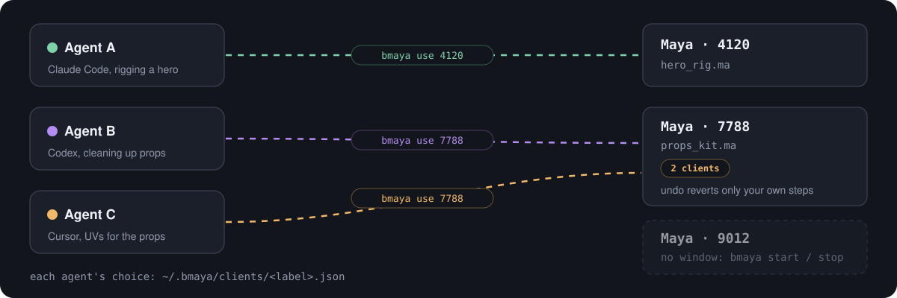

<p align="center">
  
</p>

<p align="center">
  
  
  
  
  
</p>

You type "make a low-poly barrel, give it a little bounce and export it for Unreal". Your agent opens Maya, builds the mesh, keys the animation, looks at the viewport to check its own work, runs a game-readiness audit and drops an FBX next to your project. You watch it happen in a real Maya window and can grab the mouse at any point.

That is what **bmaya-mcp** is for. It is a small [MCP](https://modelcontextprotocol.io) server that lets Claude Code, Claude Desktop, Codex or any other MCP client work inside Autodesk Maya, with a focus on the boring-but-important parts of game-dev modeling and animation.

A few things I cared about while building it:

- **Few tools, familiar names.** Eleven of them. The core ones are named like the Blender MCP tools (`get_scene_info`, `get_object_info`, `execute_maya_code`, `get_viewport_screenshot`), so an agent that has used one feels at home in the other.
- **Answers that don't flood the context.** Results are compact JSON. Every listing is capped and tells you `shown` and `total`.
- **Several Mayas, several agents.** Open three Mayas, point two agents at two of them, and nobody steps on anyone.
- **Game-dev chores built in.** Mesh audits, FBX export with Unity, Unreal and Godot presets, and animation contact sheets straight from the viewport.
- **A black box recorder.** Every command hits the disk before it runs. When Maya crashes (it will), you can see exactly what it was doing.
- **Errors that say what to do next** instead of dumping a traceback into the chat. The full traceback still goes to the Script Editor and the journal.

## How it works

<p align="center">
  
</p>

Your agent starts `bmaya-mcp` and talks to it over stdio. The server finds every running Maya and connects to a tiny bridge inside it over a local socket. The bridge is plain standard-library Python, starts together with Maya and runs each command on Maya's main thread, one at a time, wrapped in a single undo chunk.

## Take it for a spin

<p align="center">
  
</p>

Once everything is installed (see below), this runs the whole loop against your live Maya without any agent involved:

```bash
bmaya-mcp demo
```

It builds a barrel, animates it, audits the mesh, exports `prop.fbx` and saves a four-frame `screenshot.png` into `demo/` (change it with `--out DIR`). In an untitled, unmodified scene it starts fresh; in a scene with your work in it, it politely builds inside its own `bmaya_demo` group. With more than one Maya open, pass `--session ID`.

If the demo works, your agent will work too.

## Install

You need:

- Autodesk Maya with Python 3.9 or newer. I develop and test on Maya 2027.
- [uv](https://docs.astral.sh/uv/). The server needs Python 3.10+, and uv fetches it for you.
- Maya with its UI. The bridge does not run in batch mode or `mayapy`, and screenshots need a visible 3D viewport.

Windows is the only platform I have tested. The code tries hard to be portable, but nobody has run it on macOS or Linux yet. If you do, I'd love to hear how it went.

The package is not on PyPI yet, so install from a clone:

```bash
git clone https://github.com/Snuux/bmaya-mcp.git
uv tool install ./bmaya-mcp
```

`bmaya-mcp` is now on your PATH. If you'd rather not install it, `uv run --directory <path-to-clone> bmaya-mcp` works everywhere below.

Put the bridge into Maya:

```bash
bmaya-mcp install
```

This copies the bridge to `<Documents>/maya/modules/bmaya-mcp/` and writes `bmaya-mcp.mod`. If your Maya preferences live somewhere else, add `--maya-app-dir PATH` (the same flag works for `uninstall` and `doctor`).

Restart Maya. From now on the bridge starts with every GUI Maya. To check that everything is wired up:

```bash
bmaya-mcp doctor
```

It shows the installed module, live sessions, stale entries and the last crash, if there was one.

To update later: `git pull`, then `uv tool install --reinstall ./bmaya-mcp`, then `bmaya-mcp install` again so Maya gets the fresh bridge.

## Connect your agent

The server command is `bmaya-mcp` (same as `bmaya-mcp serve`). Call the server `maya` in your client.

**Claude Code**

```bash
claude mcp add maya -- bmaya-mcp
```

That one is for the current project. To have Maya in every project:

```bash
claude mcp add --scope user maya -- bmaya-mcp
```

The repo also ships a `.mcp.json`, so Claude Code started inside the clone picks the server up with no setup at all.

**Claude Desktop.** Edit `claude_desktop_config.json` (on Windows it lives in `%APPDATA%\Claude\`) and restart the app:

```json
{
  "mcpServers": {
    "maya": {
      "command": "bmaya-mcp"
    }
  }
}
```

**Codex.** Either run

```bash
codex mcp add maya -- bmaya-mcp
```

or add this to `~/.codex/config.toml`:

```toml
[mcp_servers.maya]
command = "bmaya-mcp"
args = ["serve"]
```

GUI apps often don't see your shell PATH. If the client says it can't start `bmaya-mcp`, give it the absolute path to the executable (`uv tool dir --bin` prints the folder; on Windows the file is `bmaya-mcp.exe`), or run it through uv with `args = ["run", "--directory", "<path-to-clone>", "bmaya-mcp"]`.

## The tools

| Tool | What it does |
|---|---|
| `get_scene_info` | Scene overview: file, units, up axis, fps, frame range, selection, nodes. Filter by name or node type. |
| `get_object_info` | Everything about one node: transform, bounding box, mesh counts, UV sets, materials, history, keys. |
| `execute_maya_code` | Runs Python with `cmds`, `mel` and `om` ready to use. Assign to `result` to get data back. One undo chunk per call. |
| `get_viewport_screenshot` | A PNG of the viewport. Pick a `camera`, or pass `frames` like `"1,12,24"` to get a contact sheet for animation review. |
| `audit_mesh` | Is this mesh ready for a game engine? N-gons, non-manifold, lamina and zero-area faces, UVs, materials, history, transforms, names. |
| `get_animation_info` | Curves, key ranges, tangents, fps, skeletons, skin clusters, blend shapes, anim layers. |
| `export_fbx` | FBX export with a `unity`, `unreal` or `godot` preset, optionally selection only and with baked animation. |
| `scene_file` | `new`, `open`, `save` (save-as when you give a path), `import` (`.ma`, `.mb`, `.fbx`, `.obj`). Won't throw away unsaved changes unless you set `force`. |
| `undo` | Undo the last N steps: one per `execute_maya_code` call, one per other command. |
| `list_sessions` | Running Mayas: id, scene, Maya version, busy, current. |
| `use_session` | Choose which Maya the next tools talk to. |

## Many Mayas at once

<p align="center">
  
</p>

Each Maya registers itself as a file in `~/.bmaya-mcp/sessions/<pid>.json`, and the Maya process id is the session id. With one Maya open the tools just use it. With several, they refuse to guess and return the list, so the agent calls `use_session`.

The choice lives in the memory of that agent's own server process. Another agent runs its own `bmaya-mcp serve` and can pick a different Maya. If the chosen Maya goes away, the next call says so.

The server pings every registry entry and removes the ones whose Maya is dead. A Maya that doesn't answer within 3 seconds is kept and shown as `busy`.

## FBX presets

`export_fbx` resets the FBX exporter and applies one of these. Every preset is Y up, FBX 2020 (`FBX202000`), binary, with tangents.

| Preset | Up axis | Triangulate | Smoothing groups |
|---|---|---|---|
| `unity` (default) | Y | no | no |
| `unreal` | Y | yes | yes |
| `godot` | Y | no | no |

Unreal gets triangulation and smoothing groups so its tangent space matches a bake done on the exported triangles, and the importer stops complaining about smoothing. Unity and Godot triangulate on import, so quads stay quads.

All presets export skins and blend shapes, and leave out cameras, lights, constraints and embedded textures. Hard edges and mesh smoothing are off.

With `animation=true` the exporter bakes animation at step 1 from `start` to `end`, or over the playback range when both are 0. Resampling is on, the constant key reducer is off.

Units are not converted. In Maya 2027 the `FBXExportConvertUnitString` option does nothing, and Unity, Unreal and Godot all read the unit scale stored in the file, which follows your scene's linear unit. So keep the scene in the unit you want the engine to see. `options.units` in the result tells you what was used.

`path` must be absolute and end in `.fbx`. Missing folders are created, and your selection is restored afterwards.

## When Maya crashes

Everything lives in `~/.bmaya-mcp/` (set `BMAYA_MCP_HOME` to move it):

```
~/.bmaya-mcp/
  sessions/<pid>.json                  live bridge entries
  logs/<YYYYMMDD-HHMMSS>-<pid>.log     command journal, one JSON object per line
  logs/<same-name>.crash.log           faulthandler output
  logs/server-<pid>.log                MCP server log
```

There is one journal per Maya session. Each command writes a `start` line, flushed to disk before the command runs, and an `end` line with duration and result. The 30 newest sessions are kept, and parameters over 20 KB are trimmed.

A crashed session is easy to spot: a `start` with no matching `end`, and no `bridge_stop` at the end of the file. That last `start` is what Maya was doing when it died. The `.crash.log` has the native stack when Python managed to catch it. The agent also gets an error pointing at the journal when it tries to use a dead session.

```bash
bmaya-mcp logs --crashes
bmaya-mcp logs --session 1234 --tail 50
```

The first lists sessions that look crashed, the second shows the last 50 records of one session.

## Security

The bridge listens only on `127.0.0.1`, on a random port, and every request must carry a per-session token stored in `~/.bmaya-mcp/sessions/<pid>.json`.

That is not a sandbox, though. Any local process that can read your home folder can read the token and run Python inside Maya. And `execute_maya_code` is arbitrary code execution on purpose: the agent can read and write files and start processes with your user rights. Only connect agents you trust to a Maya with anything valuable open, and don't put the home folder somewhere shared.

## Troubleshooting

**"No Maya with the bmaya bridge is running."** Either Maya isn't running, it's a batch or `mayapy` session (the bridge needs the UI), or the module isn't installed. Run `bmaya-mcp doctor`. If the module is missing, run `bmaya-mcp install` and restart Maya. The Script Editor shows bridge errors from startup.

**"Several Maya sessions are running."** Call `list_sessions`, then `use_session` with one of the ids.

**Timeout, or "did not reply in time".** Maya does one thing at a time on its main thread, and the bridge waits 50 seconds. Usually a modal dialog is in the way (a save prompt, a plug-in warning, a file dialog), or the operation is just long. Close the dialog or wait. `list_sessions` shows `busy: true` while a command runs. The command may still finish after the timeout, but its result is lost, so look at the scene before retrying. Short `execute_maya_code` calls help a lot.

**"The viewport has not been drawn yet."** Maya is still starting up or its window is minimized. Give it a few seconds or restore the window, then try again.

**Session lost.** Maya exited or crashed. See [When Maya crashes](#when-maya-crashes).

**Other Maya MCP servers.** The bridge picks a free port and keeps its own folder under `~/.bmaya-mcp`, so it shouldn't collide with other Maya MCP plug-ins. Two plug-ins running commands in the same Maya can still interleave and share one undo stack. Give each server its own name in the client, and expect agents to mix up tools with similar names.

**Screenshot fails.** You need a visible 3D viewport, and the MCP server must run on the same machine as Maya, since it reads the PNG from the temp folder.

## Uninstall

```bash
bmaya-mcp uninstall
```

```bash
uv tool uninstall bmaya-mcp
```

Restart Maya. Delete `~/.bmaya-mcp/` if you don't want to keep the logs, and remove the `maya` entry from your client config.

## Hacking on it

```bash
uv sync
uv run pytest
uv run ruff check
uv run ruff format
```

The tests don't need Maya. The Maya-side handlers do, and you can check them headless with Maya's own Python:

```bash
"C:\Program Files\Autodesk\Maya2027\bin\mayapy.exe" tests/maya/check_handlers.py
```

The bridge itself can't run in batch `mayapy` (`maya.utils.executeDeferred` never fires there), so that script calls the handlers directly.

Issues and pull requests are welcome, especially from anyone who gets it running on macOS or Linux.

## License

MIT, see [LICENSE](LICENSE).
