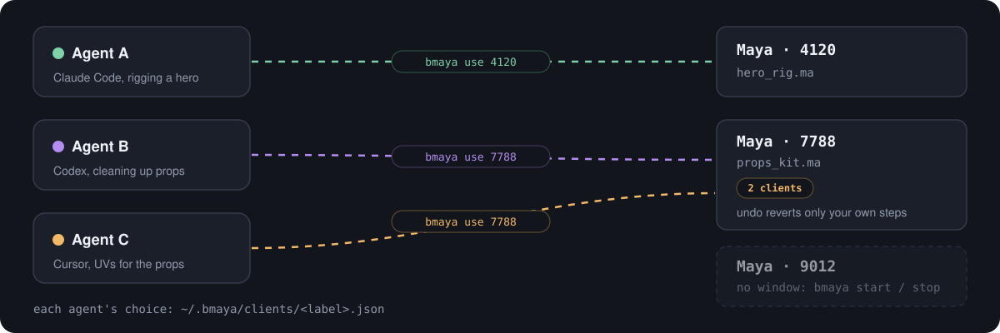

# Sessions, sharing and start/stop

How `bmaya` picks a Maya, how several agents share one, and how a Maya without a window is started and stopped.

## Several Mayas

<p align="center">
  
</p>

Each Maya registers in `~/.bmaya/sessions/<pid>.json`; the session id is the Maya process id. With one Maya running, commands use it. With several, a command fails and lists them until you pick one:

```bash
bmaya sessions
```

```json
{"sessions":[{"id":"4120","scene":"C:/work/hero_rig.ma","maya_version":"2027","busy":false,"clients":1,"current":false},{"id":"7788","scene":"C:/work/props_kit.ma","maya_version":"2027","busy":false,"clients":2,"current":false}],"current":null,"client":"claude-48d81738"}
```

```bash
bmaya use 7788
```

Each command is a new process, so the choice is kept on disk, in `~/.bmaya/clients/<label>.json`, one file per client. Another agent has another label and can pick another Maya. `--session ID` overrides the choice for a single command.

If the Maya you were using is gone, the next command fails once and says so: either the session "was stopped or closed", or it "exited or crashed", with the path of its journal. It is not silently replaced. The command after that uses another running Maya or starts a new empty one.

Every command that talks to Maya pings each registered session and deletes the entries whose Maya is dead. A Maya that doesn't answer within 3 seconds is kept and shown as `busy`.

### Who is calling

The bridge needs to know which commands come from the same agent. The client label is taken from, in this order:

1. `--client LABEL` or the environment variable `BMAYA_CLIENT`.
2. The agent's session id in the environment. Claude Code sets `CLAUDE_CODE_SESSION_ID`, which gives a label like `claude-48d81738`.
3. The nearest ancestor process that is not a shell, as `name-pid`: the agent or the terminal.

So all commands of one agent share a label, and two agents get different ones. `bmaya sessions` shows yours as `client`.

### Sharing one Maya

Several agents can pick the same Maya. Commands still run one at a time, and the bridge keeps the agents out of each other's way:

- `bmaya sessions` shows `clients`: how many callers ran a command in that Maya during the last 10 minutes. Pings and `bmaya sessions` itself don't count.
- `bmaya undo` reverts only the caller's own steps. Maya has one undo queue, so an agent can undo only while its own step is on top. If the latest change came from another client or from you in the Maya window, undo stops there and names it in `blocked_by` (a client label or `maya-ui`); with nothing undone it is an error. Selection changes don't count: undo steps over them. With `--force` the agent also undoes your UI changes that sit on top of its step. Another client's steps are never undone.
- `bmaya file new`, `bmaya file open` and `bmaya stop` are refused without `--force` when another client ran a command in that Maya during the last 10 minutes, or when the scene has unsaved changes. `save` and `import` are not restricted.

## Starting and stopping Maya

When a command needs Maya and none is running, it starts one and uses it: `mayapy` with the bridge, no window, no module install needed. The command waits up to 40 seconds. If Maya needs longer, it exits with code 3 and asks you to run it again in about 15 seconds. Two commands that start at the same moment share one Maya. `sessions`, `use`, `stop` and `demo` never start Maya.

To start one explicitly:

```bash
bmaya start
```

It waits up to 120 seconds (about 18 on one Windows machine), prints the new session and makes it your current one. `--scene FILE` opens a scene. `--gui` starts Maya with its window, which needs `bmaya install`.

There are no timers. A Maya without a window runs until you stop it:

```bash
bmaya stop
```

`stop` takes a session id if you don't mean your current Maya. Nothing asks about unsaved changes: `stop` refuses instead, so save with `bmaya file save` first or pass `--force`. It never closes a Maya that has a window; that one is yours to close.

| Variable | Meaning |
|---|---|
| `BMAYA_AUTOSTART` | What the first command starts when no Maya is running: `headless` (default, no window), `gui` (the normal Maya window, needs `bmaya install`) or `off`. |
| `BMAYA_MAYA` | Maya install folder or its `mayapy`. Default: the newest Maya in the standard install location. |
| `BMAYA_HOME` | State folder. Default: `~/.bmaya`. |
| `BMAYA_CLIENT` | Client label, see [Who is calling](#who-is-calling). |

### Screenshots without a window

A Maya without a window has no viewport, so `bmaya shot` renders through Maya's hardware renderer: 16:9, from `persp` or the camera you name with `--camera`. The result has `offscreen: true`. Frame the subject first with `cmds.viewFit("persp", all=True)`. The default `openPBRSurface` material is drawn as a plain lambert of the same base color. Commands that need Maya's UI (`modelPanel`, `getPanel`, `playblast` from your own code) do not work there.
